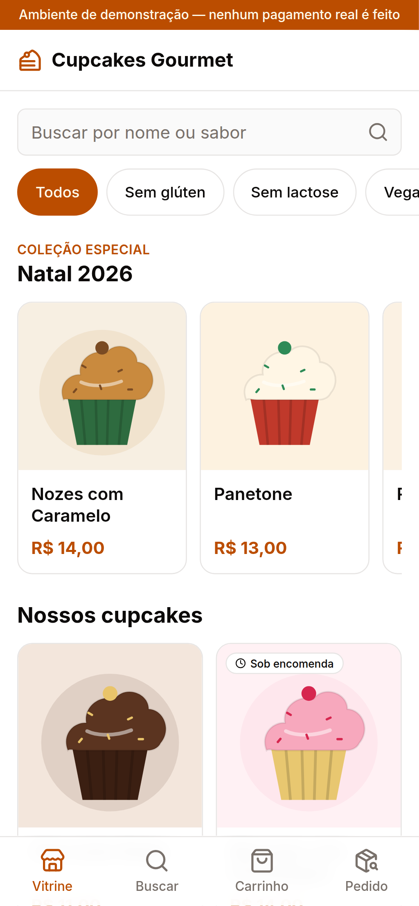
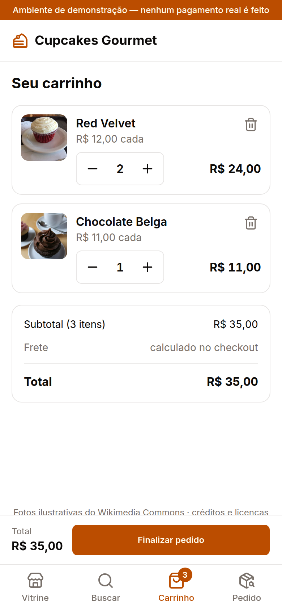
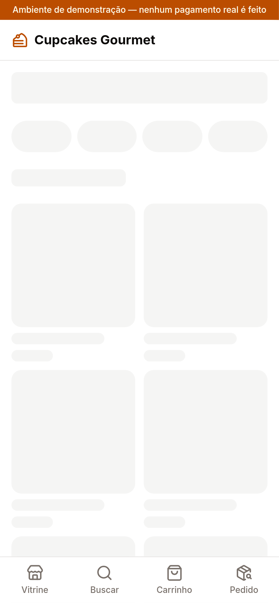
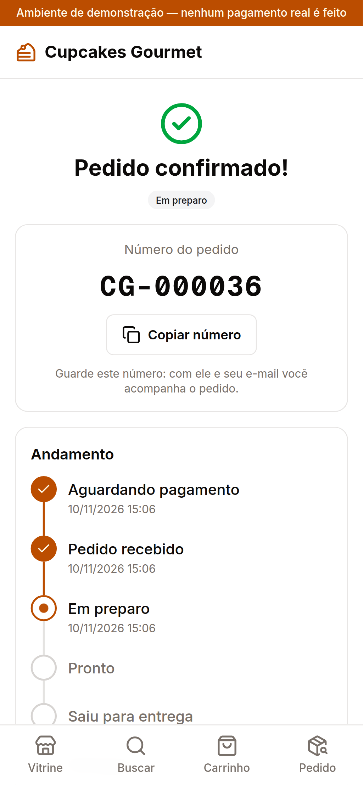
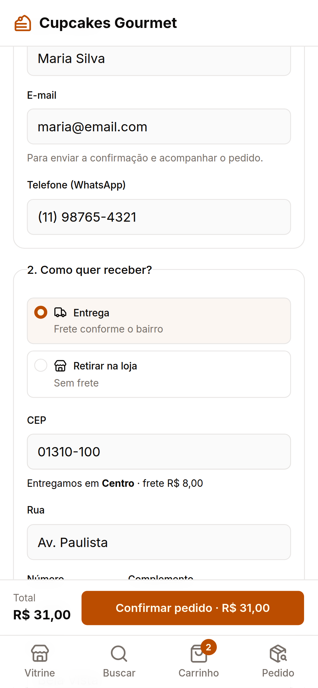
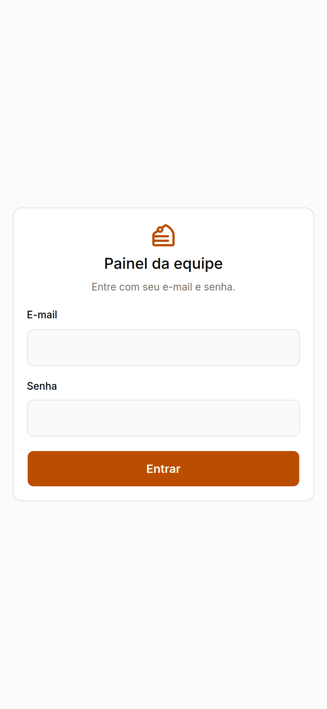
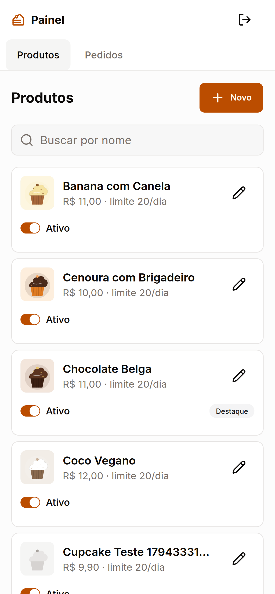
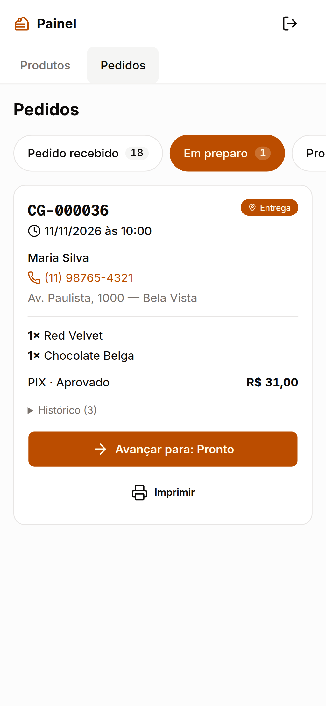

# 🧁 Cupcakes Gourmet

Webapp **mobile-first** de uma loja de cupcakes artesanais: o cliente escolhe, paga (simulado) e acompanha o pedido sem precisar de cadastro; a equipe gerencia o cardápio e a fila de pedidos pelo celular.

Projeto Integrador Transdisciplinar II (SP2) — implementação do MVP especificado no PIT I. As histórias (US-xx), regras (RN#xx) e requisitos (RNF#xx) citados no código e nos testes vêm daquele documento.

> ⚠️ **Ambiente de demonstração:** nenhum pagamento é real.

<p align="center">
  
  
  
  
</p>

## Funcionalidades

**Cliente (sem login)**
- Vitrine com coleção sazonal, selos (sem glúten, sem lactose, vegano), filtro e busca que ignora acentos e tolera erro de digitação
- Indicação de **indisponível hoje** (capacidade de produção diária) e **sob encomenda**
- Detalhe do produto com alergênicos sempre visíveis
- Carrinho salvo no aparelho, revalidado no servidor (preço, capacidade, produtos pausados)
- Checkout em página única: entrega (CEP, área e frete) ou retirada, data/horário respeitando a antecedência
- Pagamento simulado: cartão (Luhn; final `0002` é recusado), PIX (QR fictício + confirmação simulada) e dinheiro com troco
- Confirmação com número do pedido, linha do tempo que se atualiza sozinha e cancelamento antes do preparo

**Equipe (`/admin`)**
- Login com senha em bcrypt e sessão em cookie HttpOnly; perfis Admin e Atendente
- Cadastro de produtos com validação (preço > 0, alergênicos obrigatórios); produto nasce pausado
- Painel de pedidos por status, botão "Avançar para: …" (só a transição válida), histórico com responsável, cancelamento com estorno simulado e comanda de impressão
- Log de auditoria das ações da equipe

## Stack

| Camada | Tecnologia |
|---|---|
| Framework | Next.js 16 (App Router) + TypeScript + React 19 |
| Back-end | Server Components + **Server Actions** (sem API REST separada) |
| Banco | SQLite via **Prisma 7** (trocável por PostgreSQL) |
| UI | Tailwind CSS 4 + shadcn/ui (Base UI) |
| Validação | Zod — o mesmo schema valida no navegador e no servidor |
| Formulários | react-hook-form |
| Estado do carrinho | Zustand + localStorage |
| Autenticação | bcryptjs + jose (JWT) |
| Testes | Vitest (unitários e integração) + Playwright (E2E em viewport de celular) |

### Arquitetura (MVC)

```
app/           VIEW        páginas e rotas (loja e /admin)
components/    VIEW        componentes de interface
controllers/   CONTROLLER  Server Actions: validam a entrada, checam sessão e chamam o model
models/
  domain/      MODEL       regras de negócio puras, sem I/O (100% testadas)
  services/    MODEL       casos de uso transacionais (finalizar pedido, mudar status)
  repositories/MODEL       acesso ao banco (Prisma)
  schemas/     MODEL       schemas Zod compartilhados
stores/                    estado do carrinho no cliente
lib/                       banco, sessão, formatação
prisma/                    schema, migrações e seed
tests/                     unit/ e integration/
e2e/                       testes no navegador (Playwright)
```

Regra de ouro: `app/` chama `controllers/`, que chama `models/` — nunca o contrário.

## Como rodar

Pré-requisitos: **Node.js 20.19+** (testado no 24) e **pnpm**.

```bash
cp .env.example .env  # e troque SESSION_SECRET (openssl rand -base64 32)
pnpm install          # instala dependências e gera o Prisma Client
pnpm db:migrate       # cria o banco SQLite
pnpm db:seed          # carrega os dados de exemplo
pnpm dev              # http://localhost:3000
```

### Usuários e dados de teste

| Uso | Dado |
|---|---|
| Admin | `admin@cupcakes.dev` / `admin123` |
| Atendente | `atendente@cupcakes.dev` / `atendente123` |
| Cartão aprovado | `4111 1111 1111 1111`, validade futura, qualquer CVV |
| Cartão recusado | `4000 0000 0000 0002` |
| CEP atendido | `01310-100` (Centro, frete R$ 8), `05001-000` (Zona Oeste), `04001-000` (Zona Sul) |
| CEP fora da área | `20040-020` |

O seed inclui casos para demonstração: Pistache com limite diário 0 (indisponível hoje), Morango com Champagne com 48h de antecedência, Maracujá pausado e a coleção "Natal 2026".

### Scripts

| Comando | O que faz |
|---|---|
| `pnpm dev` | servidor de desenvolvimento |
| `pnpm build` / `pnpm start` | build e servidor de produção |
| `pnpm test` | testes unitários e de integração (Vitest) |
| `pnpm test:e2e` | testes no navegador em modo celular (Playwright, usa o Chrome instalado e um banco próprio) |
| `pnpm lint` / `pnpm typecheck` | ESLint e TypeScript |
| `pnpm db:migrate` / `pnpm db:seed` | migração e dados de exemplo |
| `pnpm db:reset` | apaga o banco de desenvolvimento e recria com o seed |
| `pnpm db:studio` | interface do Prisma para ver os dados |

## Testes

```
$ pnpm test
 Test Files  13 passed (13)
      Tests  127 passed (127)

$ pnpm test:e2e
  19 passed (29.2s)
```

- **Unitários** (`tests/unit/`): todas as regras de `models/domain/` — capacidade, carrinho, entrega/frete, agenda, pagamento, máquina de estados, busca, schemas.
- **Integração** (`tests/integration/`): finalizar pedido, mudar status e consultar pedido contra um banco SQLite temporário.
- **E2E** (`e2e/`): compra completa com os três pagamentos, cartão recusado, carrinho, checkout, acompanhamento, cancelamento, painel da equipe até "Entregue", permissões e **ausência de rolagem horizontal em 320px e 360px**.

A ligação entre cada critério de aceite e o teste que o comprova está em [`docs/rastreabilidade.md`](docs/rastreabilidade.md).

## Documentação

- [`docs/manual.md`](docs/manual.md) — manual de uso (cliente e equipe)
- [`docs/modelo-dados.md`](docs/modelo-dados.md) — diagrama, dicionário de dados e máquina de estados
- [`docs/rastreabilidade.md`](docs/rastreabilidade.md) — matriz história/regra → código → teste
- [`docs/plano-acao.md`](docs/plano-acao.md) — plano de desenvolvimento e decisões tomadas
- [`docs/roteiro-video.md`](docs/roteiro-video.md) — roteiro do vídeo de demonstração

## Mais telas

<p align="center">
  
  
  
  
  
</p>

## Fora do escopo do MVP

- Conta e login do cliente (US-01, US-04) — o cliente compra como convidado
- Avaliação de pedido (US-15)
- Faturamento com NFC-e/SEFAZ (US-18) — apenas a comanda de impressão foi feita
- E-mail transacional, notificação push (substituída por atualização automática a cada 20s) e gateway de pagamento real

## Deploy na Vercel (com Turso)

Na Vercel não dá para gravar em arquivo, então em produção o banco é o **Turso** (SQLite na nuvem, plano gratuito). O schema e as migrações são os mesmos: quando a variável `TURSO_DATABASE_URL` existe, o app usa o Turso (`lib/adapter.ts`); sem ela, usa o arquivo local.

1. Crie o banco em [turso.tech](https://turso.tech) (ou `turso db create cupcakes`) e copie a **URL** (`libsql://...`) e um **token** (`turso db tokens create cupcakes`).
2. Crie as tabelas e carregue os dados de exemplo:
   ```bash
   TURSO_DATABASE_URL="libsql://..." TURSO_AUTH_TOKEN="..." pnpm db:turso
   ```
3. Na Vercel, importe o repositório e defina as variáveis de ambiente `TURSO_DATABASE_URL`, `TURSO_AUTH_TOKEN` e `SESSION_SECRET` (gere com `openssl rand -base64 32`). Não é preciso `DATABASE_URL`.
4. Faça o deploy. Build e instalação usam os comandos padrão (`pnpm install` já gera o Prisma Client).

> `pnpm db:turso` pode ser rodado de novo para restaurar os dados de exemplo — ele **apaga** os pedidos existentes.

## Observações para produção

- **Banco:** em produção roda no Turso (acima). Para PostgreSQL bastaria trocar o `provider` e o adapter.
- **Concorrência:** no SQLite a checagem de capacidade dentro da transação é segura porque as escritas são serializadas; em PostgreSQL seria preciso `SELECT … FOR UPDATE` ou isolamento serializável.
- A consulta de pedido por número + e-mail não tem limite de tentativas; em produção, adicionar rate limiting.
