# Laudo de Qualidade — Cupcakes Gourmet

**Versão avaliada:** commit `fcf0f44` (10/11/2026) · **Versão corrigida:** commit `d41d846` (11/11/2026)
**Período dos testes:** 10 e 11/11/2026
**Testadores:** Luiz Matheus Soares da Silva, Lorena Bornatowski, Peterson Bornatowski, Luis Henrique Shelbauer e Gabriel Maia Gutierrez
**Método:** teste exploratório feito pelos colegas no navegador. O autor reproduziu cada falha relatada, identificou a causa no código e registrou evidências (capturas de tela e medições automatizadas com Playwright).

## 1. Resumo

| Item | Resultado |
|---|---|
| Fluxos testados com sucesso | Vitrine, filtros por selo, busca, detalhe do produto, carrinho, checkout (validações, máscaras, CEP, frete, retirada e antecedência de 48 h), pagamento PIX e em dinheiro, acompanhamento e cancelamento do pedido |
| Testes de segurança aprovados | Injeção de `<script>` na busca, adulteração de preço e quantidade no carrinho, produto inexistente ou indisponível e consulta de pedido sem e-mail |
| Defeitos encontrados | **3** pelos colegas (1 alto, 2 médios) e **1** pelo autor durante as correções (médio). **Todos corrigidos** |
| Sugestões de melhoria | **2**: busca com sugestões e imagens dos produtos. **Ambas implementadas** |
| Itens não testados pelos colegas | Responsividade, desempenho (PageSpeed) e pedido (por 1 testador). **Cobertos por evidências na seção 5** |

**Classificação de severidade**
- **Alta:** viola uma regra de negócio ou permite uma operação indevida.
- **Média:** prejudica o uso ou o layout, mas existe contorno.
- **Baixa / melhoria:** é estética ou uma sugestão.

## 2. Consolidação dos testes

| Testador | Data | Funcionou | Não funcionou | Não testado |
|---|---|---|---|---|
| Luiz Matheus S. da Silva | 10/11 | Vitrine, carrinho, pedido | Busca "precisa ser melhorada" (M1) | Responsividade |
| Lorena Bornatowski | 10/11 | Vitrine, carrinho, pedido | "Limpar filtros" não limpa a busca (D1) | Responsividade |
| Peterson Bornatowski | 10/11 | Teste completo, inclusive segurança (ver item 1) | D1, D2, D3 | Desempenho (PageSpeed) |
| Luis Henrique Shelbauer | 11/11 | Vitrine, carrinho | Imagens poderiam ser melhores (M2) | Pedido |
| Gabriel Maia Gutierrez | 10/11 | Vitrine, carrinho, itens repetidos, pedido | D1 e busca sem sugestões (M1) | Responsividade |

## 3. Defeitos

### D1 — "Limpar filtros" não limpa o campo de busca
| | |
|---|---|
| **Severidade** | Média |
| **Relatado por** | Lorena, Peterson, Gabriel (e, de forma genérica, Luiz) |
| **Passos** | 1. Buscar "Bolo de Fubá". 2. Tocar em **Limpar filtros**. |
| **Esperado** | Campo de busca vazio e vitrine completa |
| **Obtido** | A vitrine volta a mostrar todos os produtos, mas o campo continua com "Bolo de Fubá". Se o usuário digitar mais uma letra, a busca antiga volta. |
| **Causa** | O campo (`components/loja/busca-form.tsx`) é não controlado (`defaultValue`). Quando o link leva para `/`, o componente continua montado e o React não reaplica o valor inicial. |
| **Correção** | Sincronizar o campo com a URL: quando o termo da URL mudar por navegação externa (como "Limpar filtros", "Vitrine" ou o botão voltar), o campo recebe o novo valor. Incluir um teste E2E com esse passo a passo. |

| Antes: busca sem resultado | Antes: após "Limpar filtros" | **Depois:** após "Limpar filtros" |
|---|---|---|
| 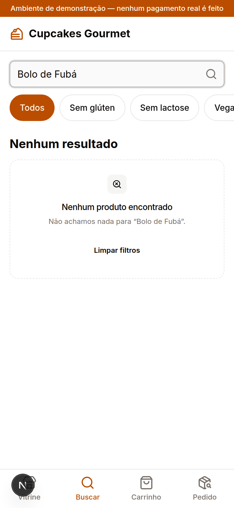 | 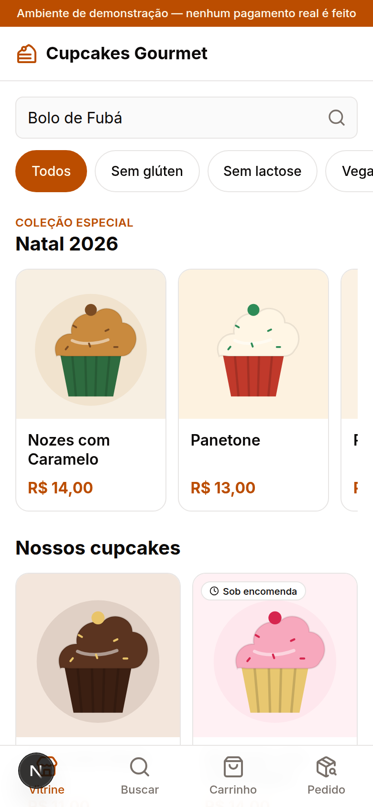 | 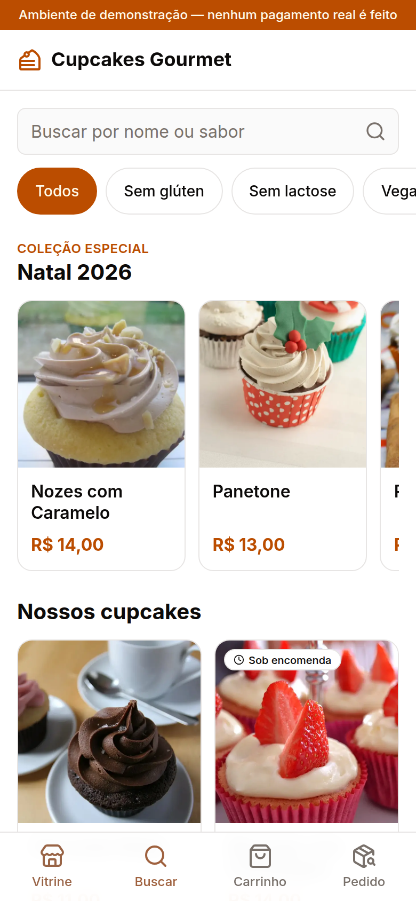 |

**Verificação:** `e2e/laudo.spec.ts` › D1. O teste busca, toca em "Limpar filtros", confere o campo vazio e, ao voltar, o termo restaurado. Commit `e48b5d4`.

### D2 — Pedido para domingo é aceito, embora a loja não abra
| | |
|---|---|
| **Severidade** | **Alta** (o servidor aceita um pedido que viola o horário de funcionamento) |
| **Relatado por** | Peterson |
| **Passos** | 1. Abrir o checkout e escolher **Retirar na loja**. 2. Abrir o calendário. |
| **Esperado** | Domingos bloqueados, como diz o aviso "Retiradas de segunda a sábado, das 10h às 18h" |
| **Obtido** | Domingos ficam liberados, com horários de 10:00 a 18:00. O pedido CG-000004 (domingo, 15/11, às 18:00) foi confirmado pelo servidor e depois cancelado pelo testador. |
| **Causa** | A regra de agenda (`models/domain/agenda.ts`) só considera antecedência e janela de 30 dias, sem dias de funcionamento. O aviso existe apenas como texto em `lib/loja.ts`. |
| **Correção** | Criar a regra `DIAS_FECHADOS = [domingo]` no domínio de agenda e usá-la no calendário (dias desabilitados), no cálculo da primeira data disponível e na validação do servidor (`dataPermitida`). Assim a rejeição acontece também numa requisição forjada. Incluir testes unitários e um teste E2E. |

| Antes: domingo 15/11 com horários | **Depois:** domingos (15, 22, 29) desabilitados |
|---|---|
| 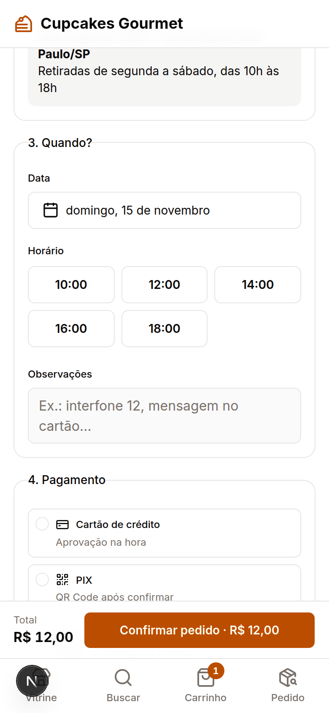 | 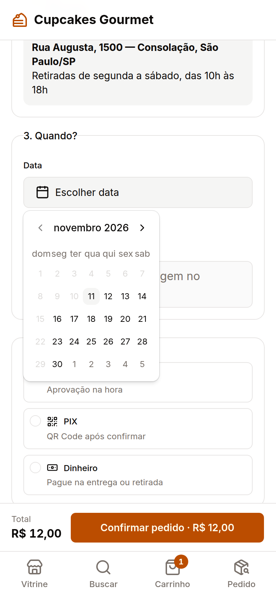 |

**Verificação:**
- `tests/unit/agenda.test.ts`: domingo sem horários, rejeitado por `dataPermitida`, e a primeira data pula o domingo.
- `tests/integration/finalizar-pedido.test.ts`: o servidor recusa o mesmo pedido de domingo, 15/11, às 18:00.
- `e2e/laudo.spec.ts` › D2: todos os domingos do calendário ficam desabilitados.

O campo de data agora informa "Abrimos de segunda a sábado.", e a regra vale para entrega e retirada. Commit `692c2d6`.

### D3 — Busca muito longa quebra o layout e não tem limite
| | |
|---|---|
| **Severidade** | Média |
| **Relatado por** | Peterson |
| **Passos** | Buscar uma palavra muito longa sem espaços (por exemplo, 5.000 letras "a"), pelo campo ou pela URL `/?busca=…`. |
| **Esperado** | Campo com limite de caracteres e mensagem que quebra a linha dentro do card |
| **Obtido** | O campo não tem `maxlength`. A mensagem "Não achamos nada para “aaaa…”" não quebra a linha, e a página chegou a **17.492 px de largura numa tela de 1.280 px**, com rolagem horizontal. O servidor aceita termos de cerca de 20 mil caracteres pela URL. |
| **Causa** | Falta limite no campo e na leitura do parâmetro `busca` (`app/(loja)/page.tsx`). Falta quebra de palavras longas (`break-words`) na mensagem. |
| **Correção** | Limitar o termo a 60 caracteres no campo (`maxLength`) **e no servidor** (o termo é cortado antes de filtrar e de exibir). Encurtar o termo na mensagem e aplicar `break-words`. Incluir teste unitário do corte e teste E2E que mede a largura da página. |

**Antes** (1.280 px, página com 17.492 px de largura):

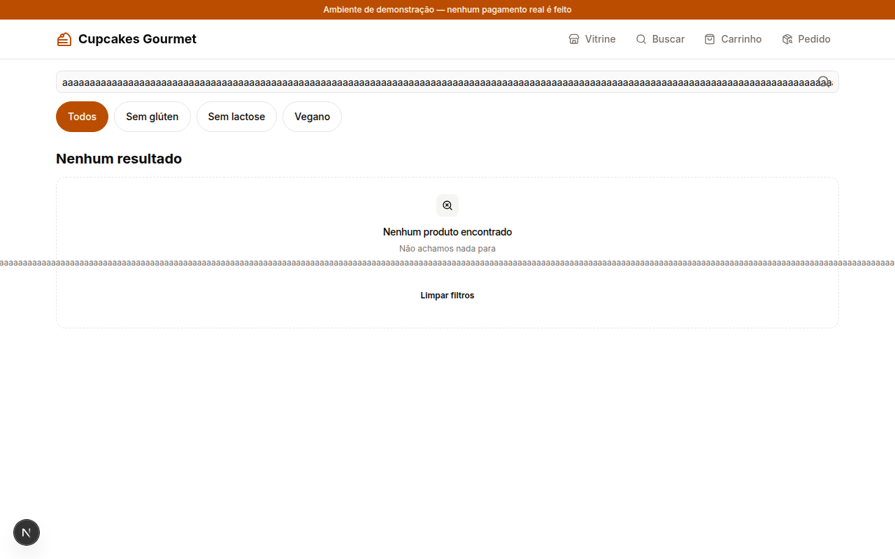

**Depois** (a página tem exatamente a largura da tela: 1.280 px e 320 px):

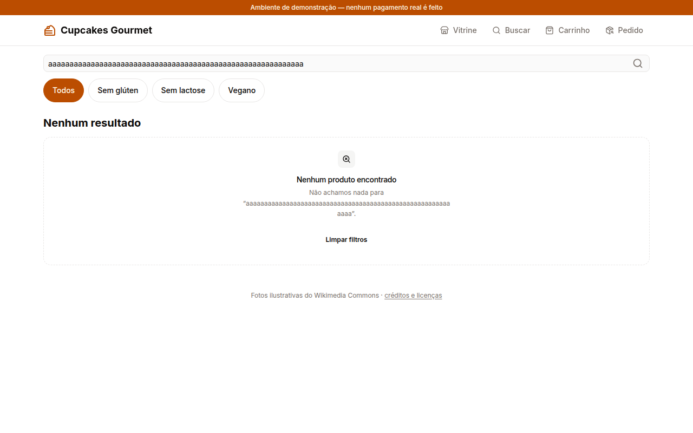 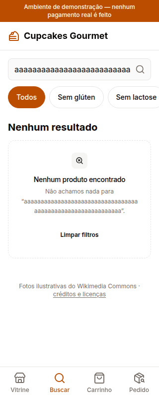

**Verificação:**
- `tests/unit/catalogo.test.ts` › termoDeBusca: o termo é cortado em 60 caracteres e um valor que não é texto é ignorado.
- `e2e/laudo.spec.ts` › D3: com 5.000 letras na URL, o campo tem `maxlength=60`, o servidor devolve 60 caracteres e não há rolagem horizontal em 1.280 px nem em 320 px.

Commits `e48b5d4` e `37b9888`.

> **Achado durante a correção:** a primeira versão da correção ainda estourava em 320 px, porque duas classes de quebra de linha se anulavam. O teste automático de rolagem não detectou o problema: no modo celular, o navegador alarga a área visível junto com o conteúdo, e o teste comparava a página com essa área. O teste passou a comparar com a largura configurada da tela. Conferimos que ele **falha sem a correção** e passa com ela, e o mesmo reforço foi aplicado ao teste de 320/360 px de todas as telas.

## 4. Sugestões de melhoria

### M1 — Busca sem sugestões quando não encontra nada
Luiz e Gabriel relataram que a busca "precisa ser melhorada" e "não busca possíveis opções". Hoje ela ignora acentos e aceita um erro de digitação por palavra, mas, quando não encontra nada, só mostra "Nenhum produto encontrado".
**Melhoria:**
- quando não houver resultado, mostrar **"Você quis dizer…"** com até 3 produtos de nome mais parecido;
- aumentar a tolerância para 2 erros em palavras com 8 letras ou mais;
- encontrar o produto a partir do início de qualquer palavra do nome ("cho" encontra "Chocolate Belga").

**Implementado** (commit `e48b5d4`):
- "Você quis dizer…" mostra até 3 produtos parecidos, cada um com link para o produto;
- palavras com 8 letras ou mais aceitam 2 erros;
- a busca por início de palavra já funcionava e agora tem teste.

As sugestões só aparecem quando a diferença é de no máximo 40% das letras, para evitar sugestões sem sentido: "bolo de fubá" continua sem sugestão, porque a loja não tem nada parecido. Verificação: `tests/unit/catalogo.test.ts` e `e2e/laudo.spec.ts` › M1.

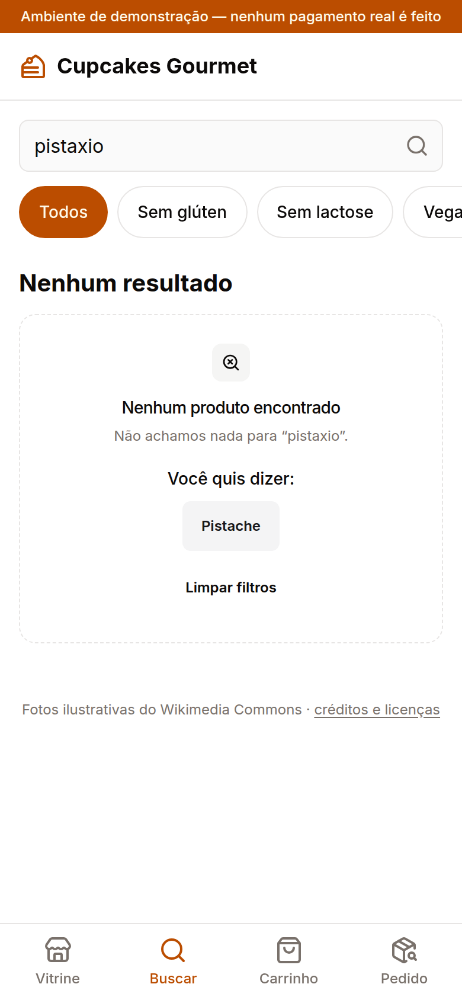

### M2 — Imagens dos produtos
Luis sugeriu imagens melhores. Hoje os produtos usam ilustrações vetoriais (SVG) genéricas, todas com o mesmo desenho e cores diferentes.
**Melhoria:** trocar por fotos de cupcakes com licença livre (Unsplash/Pexels, com crédito), otimizadas pelo `next/image`.

**Implementado** (commit `0364660`):
- 14 fotos do Wikimedia Commons (licenças CC0, CC BY e CC BY-SA), recortadas em 800 × 800 px e convertidas para WebP, de 21 a 62 KB cada;
- autor e licença em [`creditos-imagens.md`](creditos-imagens.md), com link no rodapé da loja, como as licenças exigem.

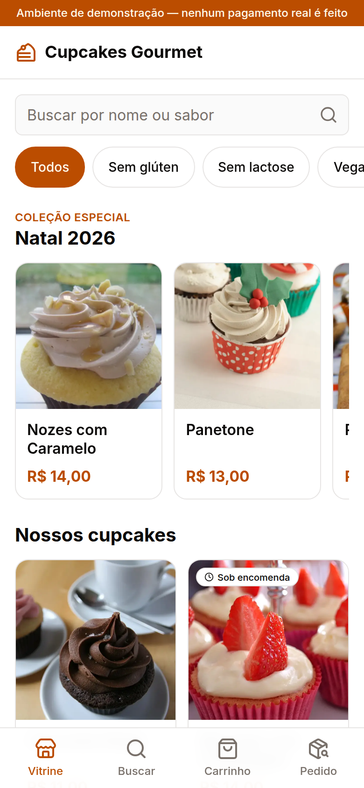

## 5. Itens não testados pelos colegas

| Item | Situação | Ação |
|---|---|---|
| Responsividade (Luiz, Lorena, Gabriel) | Já coberta por teste automatizado: `e2e/mobile-320.spec.ts` verifica que não há rolagem horizontal em 320 px e 360 px em todas as telas, e a suíte E2E roda num Pixel 7 | Anexar capturas em celular (390 px), tablet (768 px) e desktop (1.280 px) |
| Desempenho / PageSpeed (Peterson) | Não medido | Rodar o Lighthouse (o mesmo motor do PageSpeed Insights) na versão publicada na Vercel, nos modos mobile e desktop, e anexar as notas |
| Pedido (Luis) | Testado pelos outros quatro colegas e pela suíte E2E (`e2e/compra.spec.ts`: cartão, PIX, dinheiro e cartão recusado) | Nenhuma |

### 5.1 Responsividade

Vitrine em três larguras. Em todas, a página tem exatamente a largura da tela, sem rolagem horizontal.

| Celular (390 px) | Tablet (768 px) | Desktop (1.280 px) |
|---|---|---|
|  | 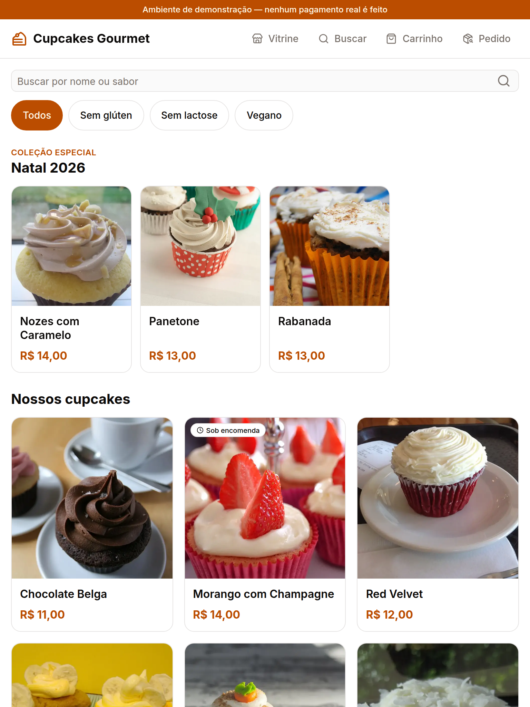 | 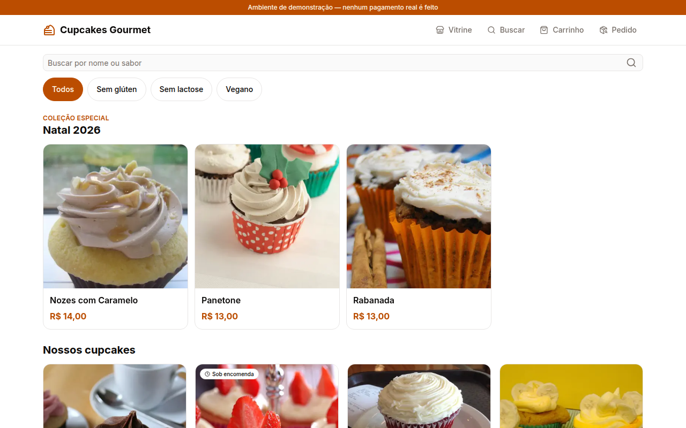 |

### 5.2 Desempenho (Lighthouse, o mesmo motor do PageSpeed Insights)

Medido na versão de produção (`next build` + `next start`), na página inicial. Lighthouse 12.8.2, celular com 4G simulado e desktop.

| Modo | Desempenho | Acessibilidade | Boas práticas | SEO | LCP | CLS | TBT |
|---|---|---|---|---|---|---|---|
| Celular | **91** | **100** | **100** | **100** | 3,4 s | 0 | 20 ms |
| Desktop | **100** | **100** | **100** | **100** | 0,7 s | 0 | 0 ms |

Relatórios completos: [`laudo/lighthouse-mobile.html`](laudo/lighthouse-mobile.html) e [`laudo/lighthouse-desktop.html`](laudo/lighthouse-desktop.html).

A primeira medição deu Acessibilidade 94 no celular. Ela apontou dois problemas, corrigidos no commit `d41d846`:
- baixo contraste no card "Indisponível hoje": o card inteiro ficava translúcido, e agora só a foto fica;
- títulos dos cards pulando do h1 para o h3.

Ela também mostrou que a primeira foto da vitrine carregava por último ("lazy"), o que atrasava o LCP. Agora as duas primeiras fotos carregam com prioridade.

> A medição oficial deve ser repetida na URL publicada na Vercel, em [pagespeed.web.dev](https://pagespeed.web.dev). O resultado varia com a rede e o servidor.

### 5.3 Outro defeito encontrado durante as correções

| ID | Defeito | Severidade | Correção |
|---|---|---|---|
| D4 | Ao abrir o carrinho, o servidor confere preços e estoque. Se a pessoa mudasse uma quantidade antes da resposta chegar (internet lenta), a resposta antiga **desfazia a mudança**. O teste E2E do carrinho passou a falhar de forma intermitente depois da troca das fotos, que deixou o servidor de desenvolvimento mais lento. | Média | Se o carrinho mudou enquanto a conferência acontecia, a resposta é descartada e a conferência é refeita com o estado atual (`hooks/use-revalidar-carrinho.ts`). Verificação: o teste do carrinho passou 5 vezes seguidas e a suíte inteira passou. Commit `f4688af`. |

## 6. Situação das correções

| ID | Descrição | Severidade | Situação | Commit |
|---|---|---|---|---|
| D2 | Pedido aceito em dia fechado (domingo) | Alta | ✅ Corrigido | `692c2d6` |
| D1 | "Limpar filtros" não limpa o campo | Média | ✅ Corrigido | `e48b5d4` |
| D3 | Busca longa quebra o layout e não tem limite | Média | ✅ Corrigido | `e48b5d4`, `37b9888` |
| D4 | Conferência do carrinho desfazia mudança (achado nas correções) | Média | ✅ Corrigido | `f4688af` |
| M1 | Sugestões na busca | Melhoria | ✅ Implementado | `e48b5d4` |
| M2 | Fotos dos produtos | Melhoria | ✅ Implementado | `0364660` |
| — | Contraste, ordem dos títulos e carregamento das fotos (Lighthouse) | Baixa | ✅ Corrigido | `d41d846` |

**Situação final dos testes automatizados:**
- 136 testes unitários e de integração passando (eram 127);
- 24 testes E2E passando (eram 19); os 5 novos, em `e2e/laudo.spec.ts`, reproduzem os passos relatados pelos colegas;
- typecheck, lint e build de produção sem erros.

O plano seguido está em [`plano-acao.md`](plano-acao.md), seção 6.
