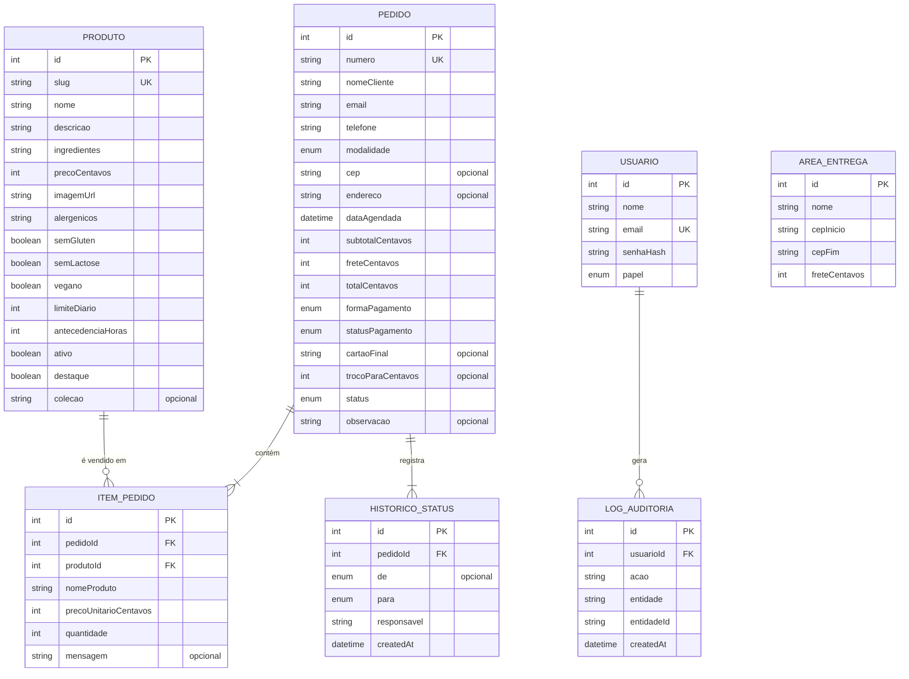
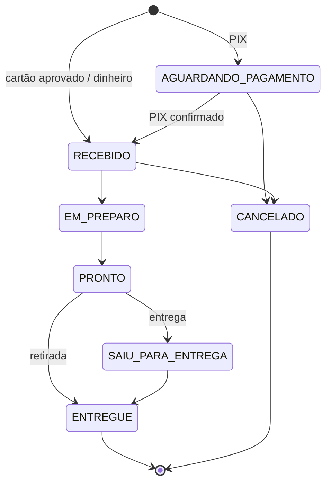

# Modelo de dados

Banco relacional **SQLite** acessado pelo **Prisma 7** (adapter `better-sqlite3`). O schema está em [`prisma/schema.prisma`](../prisma/schema.prisma) e a migração inicial em [`prisma/migrations/`](../prisma/migrations/). Trocar para PostgreSQL exige só mudar o `provider` e o adapter.

**Convenções**
- Valores em dinheiro são inteiros em **centavos** (`precoCentavos`, `totalCentavos`…). A formatação em reais acontece só na interface.
- Datas são gravadas em UTC; o "dia" da loja é sempre calculado no fuso `America/Sao_Paulo` (`lib/format.ts`).
- Campos de status usam `enum` do Prisma (o SQLite os grava como texto com validação).

## Diagrama entidade-relacionamento



`AREA_ENTREGA` não tem relação direta: o pedido guarda o CEP e o valor do frete do momento da compra.

## Dicionário de dados

### Produto
| Campo | Tipo | Regra |
|---|---|---|
| `id` | inteiro, PK | autoincremento |
| `slug` | texto, único | gerado do nome na criação; não muda ao editar (links compartilhados continuam valendo) |
| `nome`, `descricao`, `ingredientes` | texto | obrigatórios |
| `precoCentavos` | inteiro | **> 0** (RN#33) |
| `imagemUrl` | texto | caminho local (`/produtos/...`) ou URL `https://` |
| `alergenicos` | texto | **obrigatório** (RN#13); exibido sempre no detalhe |
| `semGluten`, `semLactose`, `vegano` | booleano | selos da vitrine (RN#09) |
| `limiteDiario` | inteiro ≥ 0 | capacidade de produção por dia (RN#14); 0 = indisponível |
| `antecedenciaHoras` | inteiro ≥ 0 | pré-encomenda (RN#19) |
| `ativo` | booleano | só ativos aparecem na loja (RN#08); **nasce falso** (RN#35) |
| `destaque` | booleano | aparece primeiro na vitrine |
| `colecao` | texto, opcional | agrupa a coleção sazonal do carrossel |

### AreaEntrega
| Campo | Tipo | Regra |
|---|---|---|
| `cepInicio`, `cepFim` | texto (8 dígitos) | faixa inclusiva de CEPs atendidos (RN#04, RN#17) |
| `freteCentavos` | inteiro | valor cobrado nessa faixa |

### Pedido
| Campo | Tipo | Regra |
|---|---|---|
| `numero` | texto, único | `CG-000123`, derivado do `id` (RN#24) |
| `nomeCliente`, `email`, `telefone` | texto | obrigatórios (RN#05); e-mail em minúsculas, telefone só dígitos |
| `modalidade` | `ENTREGA` \| `RETIRADA` | retirada não tem frete (RN#20) |
| `cep`, `endereco` | texto, opcional | obrigatórios só na entrega |
| `dataAgendada` | data/hora | respeita a maior antecedência dos itens (RN#19) |
| `subtotalCentavos`, `freteCentavos`, `totalCentavos` | inteiro | calculados no servidor com os preços atuais |
| `formaPagamento` | `CARTAO` \| `PIX` \| `DINHEIRO` | |
| `statusPagamento` | `PENDENTE` \| `APROVADO` \| `NA_ENTREGA` \| `ESTORNADO` | PIX começa pendente (RN#21); dinheiro é na entrega (RN#22); cancelamento de pago estorna (RN#29) |
| `cartaoFinal` | texto, opcional | **só os 4 últimos dígitos** (RNF#20) |
| `trocoParaCentavos` | inteiro, opcional | ≥ total |
| `status` | ver máquina de estados abaixo | |

### ItemPedido
| Campo | Tipo | Regra |
|---|---|---|
| `nomeProduto`, `precoUnitarioCentavos` | texto, inteiro | **cópia (snapshot)** do produto no momento da compra: mudar o produto depois não altera pedidos antigos |
| `quantidade` | inteiro ≥ 1 | soma entra no cálculo de capacidade do dia |

### HistoricoStatus
Cada mudança de status (RN#27): `de` (nulo na criação), `para`, `responsavel` (nome da pessoa da equipe, "Cliente" ou "Banco (PIX simulado)") e data/hora. Alimenta a linha do tempo do cliente.

### Usuario
Equipe da loja (RN#34). `senhaHash` com **bcrypt** (RNF#01). `papel`: `ADMIN` (produtos e pedidos) ou `ATENDENTE` (só pedidos).

### LogAuditoria
Ações da equipe (RNF#31): login, criar/editar/ativar/pausar produto, mudar status e cancelar pedido.

## Máquina de estados do pedido



Regras em [`models/domain/status.ts`](../models/domain/status.ts): só se avança uma etapa por vez; `ENTREGUE` e `CANCELADO` são terminais; cancelar só antes do preparo (RN#28).

**Ajustes em relação ao PIT I:** criado o estado `AGUARDANDO_PAGAMENTO` (para cumprir a RN#21) e pedidos de retirada pulam "Saiu para entrega". Pedido PIX ainda não pago também pode ser cancelado, para não prender a capacidade do dia.

## Capacidade diária (RN#14)

Não há tabela de estoque. A disponibilidade é calculada na hora:

```
disponível(produto, dia) = limiteDiario − Σ quantidades dos itens em pedidos daquele dia (exceto CANCELADO)
```

Pedidos aguardando pagamento PIX **ocupam** capacidade. A conferência final acontece dentro da transação que cria o pedido.
